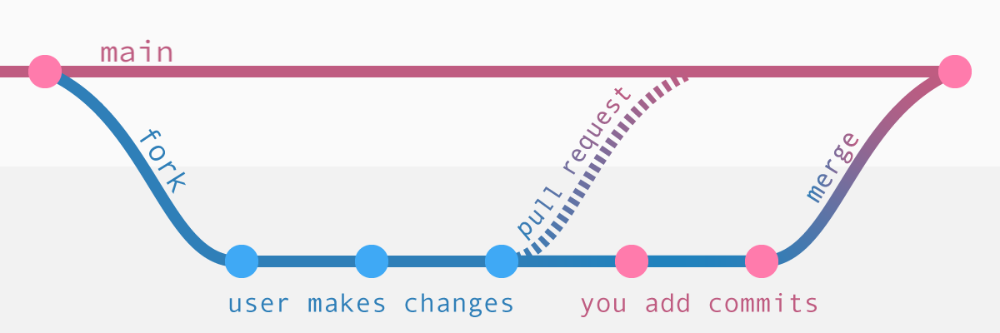
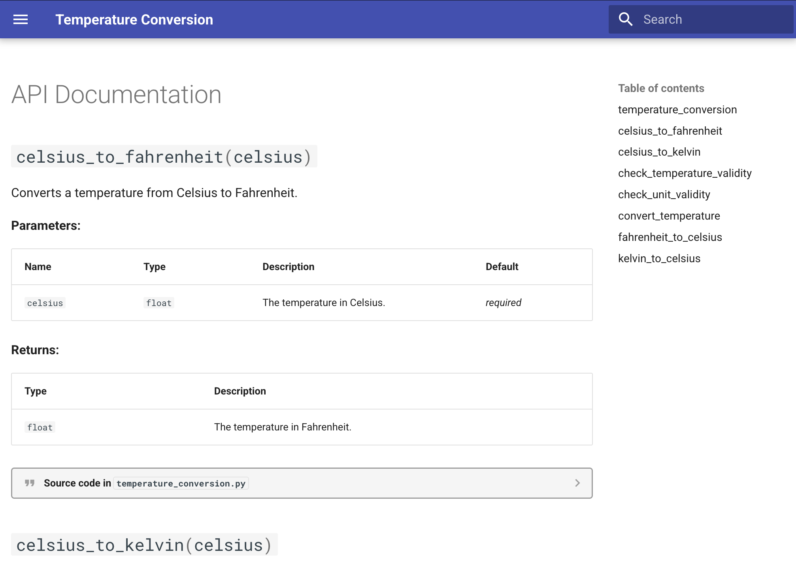

<!-- .slide: data-state="title" -->

<style>

/* Blockquote main style */
.blockquote {
    position: relative;
    font-weight: 800;
    padding: 30px 0;
    width: 100%;
    max-width: 500px;
    z-index: 1;
    margin: 80px auto;
    align-self: center;
    border-top: solid 1px;
    border-bottom: solid 1px;
}

/* Blockquote right double quotes */
.blockquote:after {
    position: absolute;
    content: "”";
    font-size: 10rem;
    line-height: 0;
    bottom: -43px;
    right: 30px;
}

/* Blockquote subheader */
.blockquote h4 {
    position: relative;
    font-size: 1.4rem;
    font-weight: normal;
    line-height: 1;
    margin: 0;
    padding-top: 20px;
    z-index: 1;
}

</style>

# Collaborative Software Development for Reuse

===

<!-- .slide: data-state="standard 10" -->

## Collaborative Software Development for Reuse

- Code Review
  - Improving the quality of code
  - Detecting bugs and code defects early
  - Increasing knowledge of the software within the team
- Preparing Software for Reuse
  - Documentation
  - `pyproject.toml` file
  - Citation file
  - License
- Packaging Software for Release

==

<!-- .slide: data-state="standard 10" -->

## Collaborative Code Development Models

- Shared Repository Model -> collaborators all work in a single repository
- Fork and Pull Model -> external contributions from forked repositories

When to use which model?

Note:

In this episode you'll learn how to work together using code review. This can be done in several ways, but we'll show you the most common way this is done in large organizations and in most open source projects: using the fork and pull method. 

===

<!-- .slide: data-state="standard 10" -->

## Developing Software in a Team: Code Review



Note:

Here's a schematic overview of the Fork & Pull method: It should remind you of a git workflow with feature branches. In principle, that's exactly what this is.

To Fork a repository means to make a personal copy of a repository in your account. Note that this is a account action which maintains the link between the repository on your account and the original one.

You can use the fork to create your feature branches for whatever changes you want to make. But instead of directly merging, you have to make a request to the original repository to accept your merge. In GitHub terms this is called a Pull Request (PR), as you're asking them to pull your changes into their repository. On GitLab, this same process is called a Merge Request (MR).

The PR is again a GitHub specific thing, which creates a place to view the proposed changes and discuss them. Any future pushed commits to the branch for which you've made the PR, will automatically update the PR.

==

<!-- .slide: data-state="standard 10" -->

## Real World example

https://github.com/TUDelftGeodesy/sarxarray/pull/67/

===

<!-- .slide: data-state="standard 10" -->

## Code Documentation

Probably the most underappreciated but most important skill of good software engineering practices. 

If I spend some time now on documenting my code well, this will save me time and headaches later.

Note:

Another important part of online collaboration and preparing your code for reuse and release is to create a good README. This is the billboard for your repository and is shown as your 'homepage' on GitHub. There are several best practices of what should be included in a README, which you will learn about in this episode.

Documentation does not only help others, but also yourself: if you work on other projects and come back later, you will have forgotten most of the details.

===

<!-- .slide: data-state="standard 10" -->

## Types of Documentation

- README file
- In-code documentation and Docstrings
- User documentation
- Tutorials
- ...

===

<!-- .slide: data-state="standard 10" -->

## A good README

- A descriptive project title
- Motivation (why the project exists) and basics
- Installation / How to setup
- Badges
- Contributing guidelines
- ...

Examples:
- https://github.com/numpy/numpy
- https://github.com/pydata/xarray

===

<!-- .slide: data-state="standard 10" -->

## In code documentations

Do not use it:
- When the code is self-explanatory
- To replace good variable/function names
- To replace version control
- To keep old (zombie) code around

==

<!-- .slide: data-state="standard 10" -->

### Commented Code

```python
# convert from degrees celcius to fahrenheit as 
def convert(d):
    return d * 5 / 9 + 32
```

### Readable Code

```python
def celcius_to_fahrenheit(degrees: float) -> float:
    return degrees * 5 / 9 + 32
```

==

<!-- .slide: data-state="standard 10" -->

### Keeping Zombie Code

```python
# Do not run this code!:
# if temperature > 0:
#     print("It is warm")
```

### Replacing Git

```python
# removed on August 5
# if ...
# Now it connects to the API with o-auth2, updated 2026-05-05
```

==

<!-- .slide: data-state="standard 10" -->

## Docstrings: a special kind of comment

<div style="display: flex; gap: 1em; font-size: smaller;">
<div style="flex: 2;">

<pre><code class="bash" style="overflow: hidden;" data-trim class="bash" data-line-numbers>
def celcius_to_fahrenheit(degrees: float) -> float:
    """Convert degrees Celcius to degrees Fahrenheit.

    Parameters
    ----------
    degrees : float
        Temperature in degrees Celcius.

    Returns
    -------
    float
        Temperature in degrees Fahrenheit.
    """
    return degrees * 5 / 9 + 32
</code></pre>

</div>
<div style="flex: 1;">
VSCode plugins like autoDocstring can help you generate docstrings!
</div>
</div>

Note:

Plugin URL: https://marketplace.visualstudio.com/items?itemName=njpwerner.autodocstring

===

<!-- .slide: data-state="standard 10" -->

## User Documentation

Options include _MKDocs_ (Zensical) and Sphinx



Note:

Urls:
- MKDocs https://www.mkdocs.org
  - Typically used with Material for MKDocs https://squidfunk.github.io/mkdocs-material/
  - EOL as of 2027-05-05
- Zensical (standalone (Material for) MKDocs successor) https://zensical.org
- Sphinx: https://www.sphinx-doc.org/en/master/index.html
  - To use with markdown, include the MyST Parser extension https://www.sphinx-doc.org/en/master/usage/markdown.html#markdown

===

<!-- .slide: data-state="standard 10" -->

## `pyproject.toml`

Contains metadata for your package
- Name, authors, description, version number
- Installation dependencies (`pip install .`)
- Tool options (ruff, pytest, ...)

===

<!-- .slide: data-state="standard 10" -->

## License

Visible online != permission to use

You(r institution) still has copyright by default.

<div class="fragment" data-fragment-index="2">

Add a license to allow usage.
- Apache 2.0
- MIT
- GPL
- ... and many more

</div>

===

<!-- .slide: data-state="standard 10" -->

## Citation

You want to be acknowledged for your efforts!

Including a `CITATION.cff` file makes it easy to do so

```
authors:
  - family-names: Doe
    given-names: John
cff-version: 1.2.0
message: "If you use this software, please cite it using the metadata from this file."
title: "Inflam"
```
<!-- .element: class="fragment" data-fragment-index="2" -->

===

<!-- .slide: data-state="standard 10" -->

## Packaging

`uv` can use the information in `pyproject.toml` to _build_ your package

The `.whl` file produced can be installed by `pip`
<!-- .element: class="fragment" data-fragment-index="2" -->

This is what you find on PyPI
<!-- .element: class="fragment" data-fragment-index="2" -->
