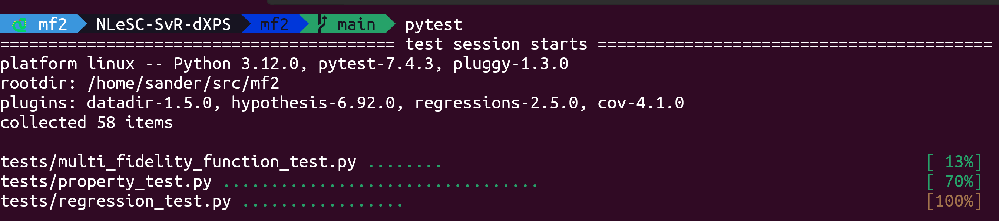
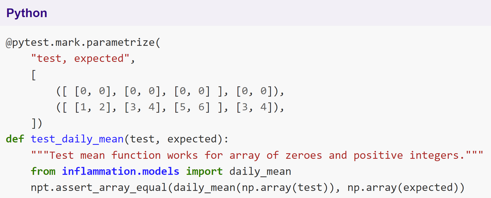
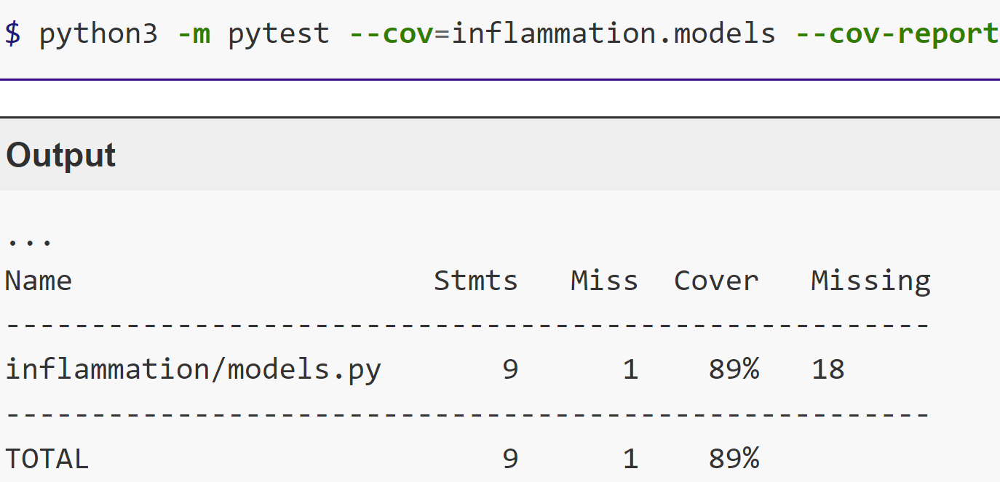
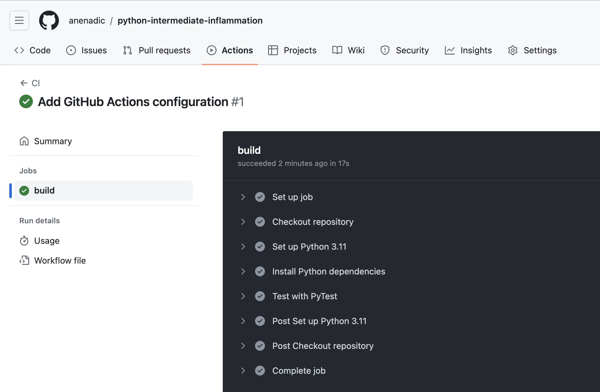
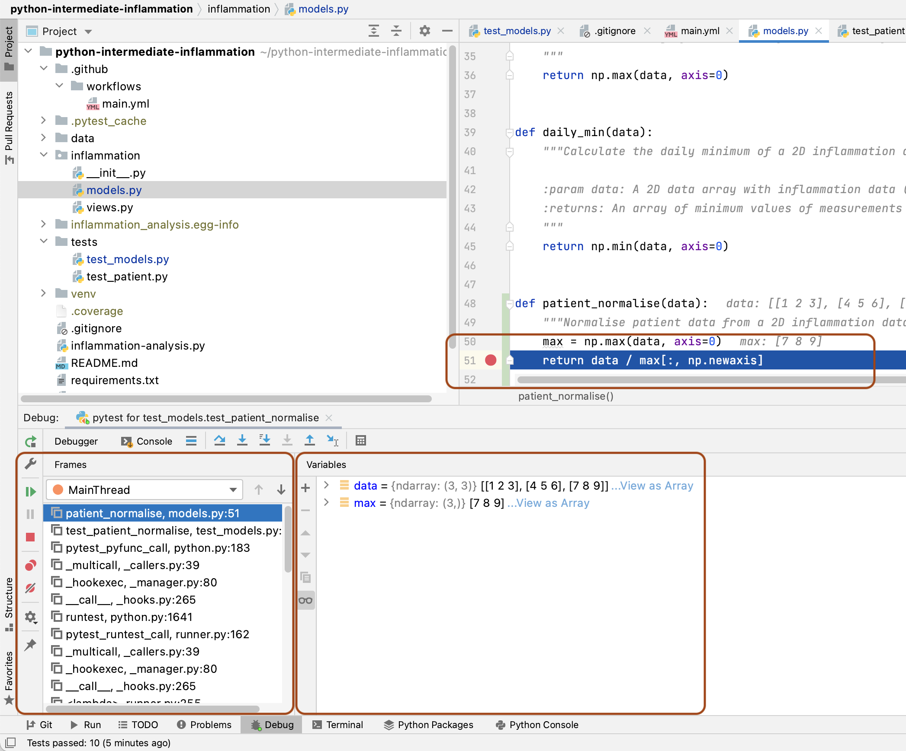

<!-- .slide: data-state="title" -->

# Ensuring Correctness of Software at Scale

===

<!-- .slide: data-state="standard 10" -->

## Introduction

As researchers we need to be able to verify and demonstrate that our code produces correct results.

_Unit testing_ - when done in the right way - can help, as well as save us development time in the long run

==

<!-- .slide: data-state="standard 10" -->

## Introduction

- Software testing and unit testing
  - An example dataset and application to test for correctness
  - Writing and running tests using the Pytest unit testing framework
  - Using parameterisation to reuse unit tests with different test data

- Continuous Integration (CI)
  - Using GitHub Actions to automate running of unit tests
  - Build matrices for cross-platform testing using CI

- Debugging issues and improving robustness
  - Using PyCharm's debugger to diagnose and robustly fix a problem

Note:

[Any questions or issues from last week’s material?]

Last week we looked at setting up a development environment
- In particular, how we can use some commonly used tools to do this
- With the command line we set up a virtual environment for our project
- And used feature branch workflow to organise how we develop our codebase
- We also looked at PyCharm, and how its features can help us

Today is about seeing what tools can help us verify that our software is - in some way - correct
And works the way we expect it to
- We'll we looking at unit testing as one established way to do this automatically,
- Writing some tests using the pytest unit test framework, and running them to check our code's behaviour
- We'll also be looking at ways we can scale up and further automate our unit testing,
- Using parameterisation to reuse unit test code with different sets of test data
- And GitHub's continuous integration features to automatically run our tests on our code repo for us
- We'll also be looking at how we can use PyCharm's code debugger to check the behaviour of our code as it runs
- To help us identify a bug and fix it

Overall, I'd say a key message is that as responsible researchers it's a good idea to be able to demonstrably show that our code produces correct results
- At the Institute we've worked with many researchers, some of whom could not categorically say how or sometimes even why - their software's results were correct (were they even correct??)
- Unit testing is one approach that can help us here
- And that unit testing - in the long run - can save us development time if used correctly

Any questions before we begin?

===

<!-- .slide: data-state="standard 10" -->

## Automatically Testing Software

Note:

Everyone is used to testing their software in one way or another. The simplest way is manual interactive testing, where you call your function manually in, for example, a Jupyter notebook and check the output is what you expect.

This works fine for the first few functions you write, but it doesn't really scale when your project gets larger. Especially when you get functions depending on other functions, it's too hard to manually keep track of which functions we *have* to test anyway.

Besides, constantly doing the same thing in order to perform manual tests sounds an awful lot like something we can automate right? That's exactly what automated testing is: writing functions to perform the testing you would otherwise do manually. The obvious benefit being that once you have these tests, the computer can automatically run them all for you.

===

<!-- .slide: data-state="standard 10" -->

## Scaling Up Unit Testing

  

  

Note:

Once you've started with tests, or unit tests specifically, you'll probably notice a similar thing happening as in your regular code: repetitions.
Testing a certain function for different cases can of course be done by repeating the same test code with different values. In your 'normal' code, you would solve this with for-loops. This will still work in tests too, but then each case would not be shown as a separate test.
Pytest has a solution for this: parametrization. You'll learn how you can still specify your test to work on a single case at a time, and then specify the different cases above it. Pytest then takes care of running each of them.

The goal of having different cases is to make sure that all possible ways your code can run are checked. In testing terms, this is usually refered to as coverage. By running your tests with coverage, it'll let you know which lines are or aren't covered. This is a great way to check if you're forgetting to test any cases your code can handle, or to help decide what tests to write next.
Don't get distracted by the percentage coverage number though. It's very easy to write tests to get 100% test coverage, without actually testing anything of your code. As with anything: a metric can quickly stop being helpful when you use it as a goal.

===

<!-- .slide: data-state="standard 10" -->

## Continuous Integration for Automated Testing

Note:

When you've written your tests, it would of course be best to have your tests run automatically too. When working with GitHub as your remote repository, you can configure GitHub to automatically run all tests when new commits are pushed to a branch, or on other triggers. This means you'll automatically get feedback on your code, even if you forgot to run the tests on your own machine before pushing the changes. This functionality is called 'GitHub Actions', and GitHub very kindly allows every project some free minutes of runtime at this.

===

<!-- .slide: data-state="standard 10" -->

## Diagnosing Issues and Improving Robustness

Note:

Finally in this episode, you'll have a look at PyCharm's debug mode. It's a different way of running your code in PyCharm that's a bit slower, but will let you interrupt your program using preset break points so you can step through your code one instruction at a time. When stepping through code, PyCharm will let you look at the current values of all variables that exist in your program, and tells you exactly which functions were called to get to where you currently are.
This not only works when you've manually set break points, but also when your code runs into an exception on its own. Both ways are great tools to track down bugs and to determine how to fix them.
Remember that when you've found (and fixed) a bug, that those situations make excellent test cases, usually referred to as 'Regression tests'. By writing tests of the situations that could be used to recreate bugs you've encountered and fixed, you'll guarantee that the same bug shouldn't pop up again. Or at least not undetected! 

===
