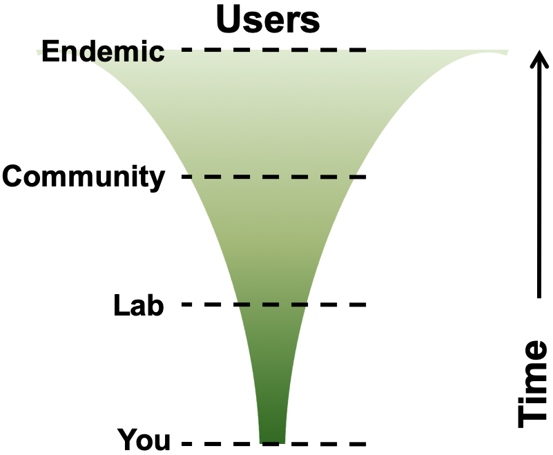
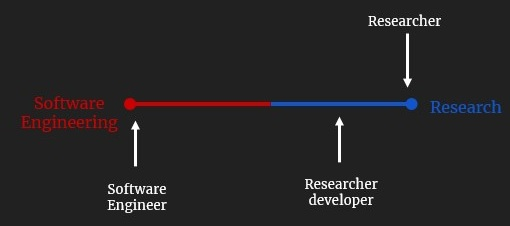

<!-- .slide: data-state="title" -->

# Intermediate Research Software Development in Python

note:

===

<!-- .slide: data-state="standard" -->

## Introduction

- What is this course about?
- Why should I consider how I engineer my projects?
- How is this course organised?

===

## Modern research is impossible without software

From thrown-together scripts, through an abundance of complex spreadsheets, to the millions of lines of code behind large-scale infrastructure, there are few areas where software does not play a fundamental part in research​

===

## The software you write is important!

<ul>
  <li>Software inherently contains <i>value</i>, not a throw-away artifact
   
  <li>Difficult to gauge to what extent it might be used in the future
  <ul>
    <li>By who?
    <li>Which parts?
    <li>Which projects?
    <li>Reproducibility of results &mdash; from publications!
  </ul>
</ul>

  

Can/should it be reusable by others? ...including yourself?

===

## When should you have considered how to engineer your software?

  

      The best time to plant a tree is 20 years ago. The second best time is now.
  

  

===

## Programming vs Software Engineering

  Programming / Coding
  <ul>
    <li>Focus is one aspect of software development (implementation)
    <li>Writes software for themselves
    <li>Mostly an individual activity
    <li>Writes software to fulfill research goals (ideally from a design)
  </ul>

  Engineering
  <ul>
    <li>Considers the <i>lifecycle</i> of software
    <li>Writes software for <i>stakeholders</i>
    <li>Takes <i>team ethic</i> into account
    <li>Applies a <i>process</i> to understanding, designing, building, releasing, and maintaining software
  </ul>

  

      Programmers tend to start coding right away. Sometimes this works.
    <h4>&mdash; Eric Larsen, 2018</h4>
  

Note:
What's the difference between programming and software engineering?

===

## Target Audience

A researcher developer, with foundational coding skills, now facing new challenges​

- Software projects becoming more complex​
- Scale of development increasing​
- More collaborative development and use, internal or external​
- Higher expectations on software​
- Increase in requests for change, more 'technical debt'​

===

## Course Outline

1. Environment for Collaborative Code Development
   - Setting up our software project, development environments and tools, virtual environments, Git & GitHub, coding conventions​
2. Ensuring Correctness of Software at Scale
   - Automatically testing your software, unit tests, continuous integration,​ debugging, improving code robustness​
3. Software Development as a Process
   - Software requirements, design, architecture and implementation (via programming paradigms) as typical stages of a software development process​
4. Collaborative Software Development for Reuse
   - Code review, documenting and preparing/packaging software for release and reuse​
5. Managing and Improving Software Over Its Lifetime
   - Tracking issues, managing team communications and software project planning and management

===

## How will the workshop run

Delivery is helper-supported self-learning (no live coding)​

- We will introduce each part with a short presentation
- Learners go through material individually (at their own pace)​
- You work together in groups of 4-5 people​
- Trainers will be available to assist with problems and answer questions​
- Initially exercises are performed individually, more group/team work in later stages when we will need to keep more in sync with everyone in a group​
- Feel free to ask questions and start discussions with people in your group or instructors. This is a good opportunity to ask related questions about your daily work as well.
- We will remind you to take regular breaks

===

## A final note ...

About working through the material

- Start from the actual section introduction - bigger picture​
- Exercises - try to do them on your own (before looking at the solution)​
- Exercises - don't skip them! Some later materials depend on this​
- Optional exercises are clearly marked - all other exercises should be completed​
- Please finish the section in the rest of the week if you were note finished. Note that section 1 is a bit bigger than the other sections.​
- We wrap up together at the end of the day. If you finish the section early you can work on the optional exercises in the collaborative document​
​
Please ask for help - do not suffer in silence!​

- Ask for help if needed ​
- We know from experience that some people don't like to read, especially not at the end of the day when you feel like everyone else is moving faster than you. Ask an instructor to explain instead of reading the texts!​

===

## The story ...

  You have just joined a team that works on an existing software project. The project is written in Python and studies and analyses inflammation in a group of patients that have been given a new treatment for arthritis in a medical trial. The software project is not finished and contains some bugs and tests that are failing. Over the course - you will work either individually or with your colleagues to develop more code and fix these errors.​

  

