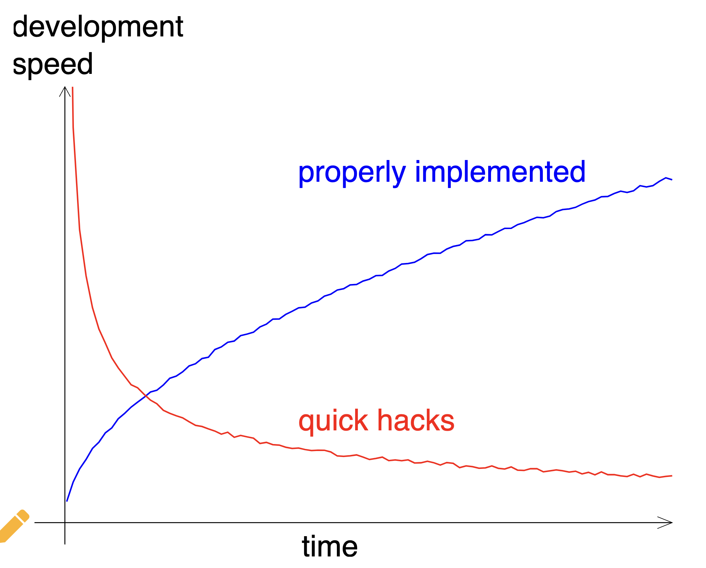

<!-- .slide: data-state="title" -->

# Wrapping up

===

<!-- .slide: data-state="yellow_flag logo 9" data-background="./media/image62.jpeg" data-background-size="100%" -->

<!-- Move this text to top of page -->
Congratulations! You have transformed from a simple programmer to a full-grown software engineer!

===

<!-- .slide: data-state="standard 10" -->

  

- Design
- Requirements
- Automated testing
- Code quality
- Linter
- Continuous Integration
- Packaging
- Documentation
- Peer review
- Project organisation
- Feature branching

===

<!-- .slide: data-state="standard 10" -->

We can teach you useful skills,  but in software engineering experience matters…

<!-- .element: class="fragment" data-fragment-index="1" -->

Note:

After this workshop, there is however an elephant in the room.

We've now taught you all these different concepts, but in the end, to actually apply these software engineering practices will take something we can't teach: Experience. You'll have to work on it, try these techniques on your repositories, and observe how they are (or aren't) used on the repositories of others.

==

<!-- .slide: data-state="standard 10" -->

## Next Steps

- Apply what you learned in your own projects.
  - Measure code coverage and code quality, slowly build this up over time.
- Self-learning (see collaborative documents for resources)
  - Read a book
  - Watch youtube
  - Online courses and tutorials

==

<!-- .slide: data-state="standard 10" -->

What did you learn that is maybe more important than experience?

==

<!-- .slide: data-state="standard 10" -->

# Attitude

===
