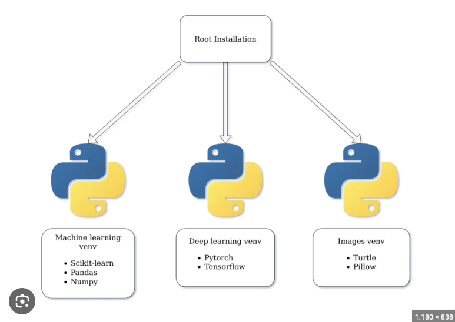
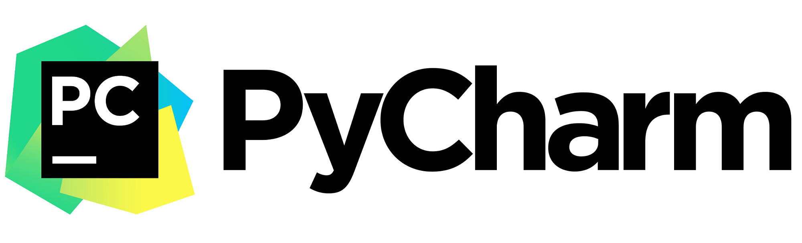
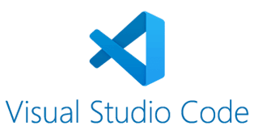
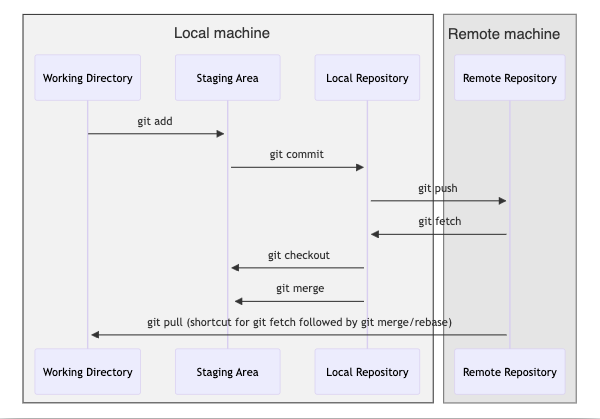
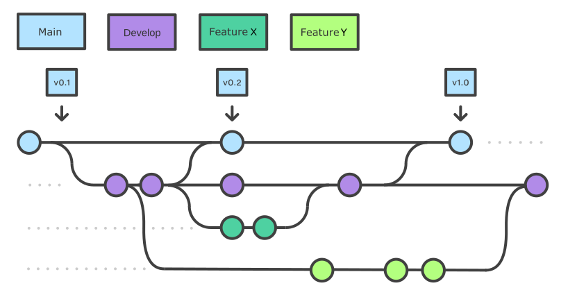
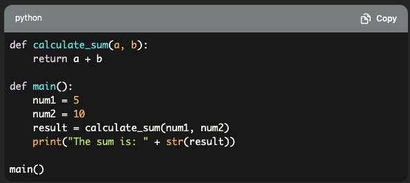
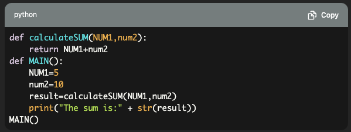

<!-- .slide: data-state="title" -->

<style>

/* Blockquote main style */
.blockquote {
    position: relative;
    font-weight: 800;
    padding: 30px 0;
    width: 100%;
    max-width: 500px;
    z-index: 1;
    margin: 80px auto;
    align-self: center;
    border-top: solid 1px;
    border-bottom: solid 1px;
}

/* Blockquote right double quotes */
.blockquote:after {
    position: absolute;
    content: "”";
    font-size: 10rem;
    line-height: 0;
    bottom: -43px;
    right: 30px;
}

/* Blockquote subheader */
.blockquote h4 {
    position: relative;
    font-size: 1.4rem;
    font-weight: normal;
    line-height: 1;
    margin: 0;
    padding-top: 20px;
    z-index: 1;
}

</style>

# Setting Up For Collaborative Code Development

===

<!-- .slide: data-state="standard 10" -->

## Introduction

<div class="blockquote-wrapper fragment">
  <div class="blockquote" style="margin: 30px auto 0; font-size: smaller;">
      Anyone can write code that a computer can understand. Good programmers write code that humans can understand.
    <h4>&mdash; Martin Fowler, a British software engineer, author and international speaker on software development</h4>
  </div>
</div>

==

<!-- .slide: data-state="standard 10" -->

## Introduction

In order to develop (write, run, test, debug, backup) code efficiently, you need to use a number of different tools interchangeably.

- Introduction to software project and software development tools (refresher)​
  - Command line, IDE, Git + GitHub ​
- Setting up virtual development environment to isolate code (pip, venv)​
- Writing and checking for well-formatted and readable code - PEP8 coding style convention & linting​

Note:

In this section, you will familiarise yourself with the software project and learn the tools other members of the team are using. There is a number of tools that are used in conjunction for software development on this project and you need to set them all up on your machine and get used to using them all interchangeably as you would in a real-life team development setting.
For the purpose of this course, we selected a number of free and open source tools that we believe make a difference:
- **Command line tools** to run the code, install dependencies and set up a virtual development environment.
- **PyCharm IDE** - a rich software development environment for developing, testing and debugging code.
- **Git** to version control our code and GitHub to share it with the team and manage issues, communications and our software as a project.
These tools are certainly not mandated in practice - you will often in practice have a choice of different similar tools - however for the purpose of this course we had to make a choice and hope that the knowledge you pick on here is transferable to other similar tools you may use in future.

Key message
- In order to develop (write, test, debug, backup) code efficiently, you need to use a number of different tools interchangeably
- Which tool is right for you which depends on personal preference or what the community you belong to is using - we only try to cover transferable concepts here

Link to materials: https://softwaresaved.github.io/az-intermediate-software-skills-course/index.html

===

<!-- .slide: data-state="standard 10" -->

## 1.1 Introduction to our software project

Patient Inflammation Study Project


==

<!-- .slide: data-state="standard 10" -->

## Project structure

```
├── data
│   ├── inflammation-01.csv
│   …
│   └── inflammation-12.csv
├── inflammation
│   ├── __init__.py
│   ├── models.py
│   └── views.py
├── inflammation-analysis.py
├── LICENCE.md
├── pyproject.toml
├── README.md
└── tests
    ├── test_models.py
    └── test_patient.py
```

==

<!-- .slide: data-state="standard 10" -->

## Model – View – Controller architecture


- Model (represents the data)
- View (interacts with the user), and
- Controller (handles input and output).

<!-- .element: class="fragment" data-fragment-index="1" -->

Example:
<!-- .element: class="fragment" data-fragment-index="2" -->
- In View, click "summary of results for these 10 patients"
- Controller accepts input and asks Model for appropriate data
- Model retrieves the data and sends it to Controller
- Controller analyses the data and sends it to View
- View presents the results

<!-- .element: class="fragment" data-fragment-index="2" -->

Note:

The current project does not actually have a clickable GUI.
For the listed example, just pretend that it does.

==

<!-- .slide: data-state="standard 10" -->

## Model – View – Controller architecture

- It makes sense to gather functionality that is related to each other in a module and make it clear how modules interact with each other (how they ‘interface’).

- This makes the code more **modular**, and thereby more **reusable, readable, and manageable**. We will get back to this in section 3.


===

<!-- .slide: data-state="standard 10" -->

## Instructions

- Follow instructions for "Downloading Our Software Project" (also carry out the exercise)
- Quickly go over "Our Software Project’s Structure", which we have covered in the presentation.

===

<!-- .slide: data-state="standard 10" -->

## 1.2 Virtual Environments for Software Development


<div style="display: flex; gap: 1em;">
<div style="flex: 2;">
  
</div>
<div style="flex: 1;">

Is there anyone who already uses virtual environments?
<!-- .element: class="fragment" data-fragment-index="1" -->

Why is this useful?
<!-- .element: class="fragment" data-fragment-index="2" -->

</div>
</div>

==

<!-- .slide: data-state="standard 10" -->

## 1.2 Instructions

- Go through introductory sub-sections on virtual environments in Python, especially if not familiar with the topic.
- Follow instructions, which guide you through setup of venv and pip.
- If you consider yourself experienced on the topic, try out `uv`.

Note:

[`uv`](https://docs.astral.sh/uv/) by Astral is a project management tool for Python. It is written in Rust for performance.
It provides a re-implementation of pip, but can also be used as a standalone project/package management tool that can even install Python itself for you.

===

<!-- .slide: data-state="standard 10" -->

## 1.3 Integrated Developer Environment

- An Integrated Development Environment (IDE) is a very powerful editor that has a lot of useful extra features. 
- If you do not want to you do not have to leave the environment while programming.
- What do you use? And why?

==

<!-- .slide: data-state="standard 10" -->

## 1.3 Instructions

Pick an IDE:
- PyCharm: Python-oriented, free community edition (free pro versions for educational institutions).
- Visual Studio Code (VS Code): free general-purpose IDE.

Follow instructions to configure the selected IDE. 

<div style="display: flex; gap: 1em;">
<div style="flex: 1;">
  
</div>
<div style="flex: 1;">
  
</div>
</div>

===

<!-- .slide: data-state="standard 10" -->

## 1.4 Software development using git and GitHub



==

<!-- .slide: data-state="standard 10" -->

## Git feature branches



==

<!-- .slide: data-state="standard 10" -->

## 1.4 Instructions

- If you are familiar with git, you may skip the 'Git refresher' sub-section.
- Follow instructions, running all code chunks (later material depends on some of them).

===

<!-- .slide: data-state="standard 10" -->

## 1.5 Python code style conventions

Which is more readable?

<div style="display: flex; gap: 1em;">
<div style="flex: 1;">
  
</div>
<div style="flex: 1;">
  
</div>
</div>

==

<!-- .slide: data-state="standard 10" -->

## 1.5 Instructions

- Mainly descriptive episode, the two exercises are the 'active' parts.
- Strongly linked to following episode.

===

<!-- .slide: data-state="standard 10" -->

## 1.6 Verifying Code Style Using Linters

- Code linter: identify style issues and (basic) errors via static code analysis.
- Linters show issues in a report-style.
- Many tools for the job – here we will have a look at Ruff.

===
