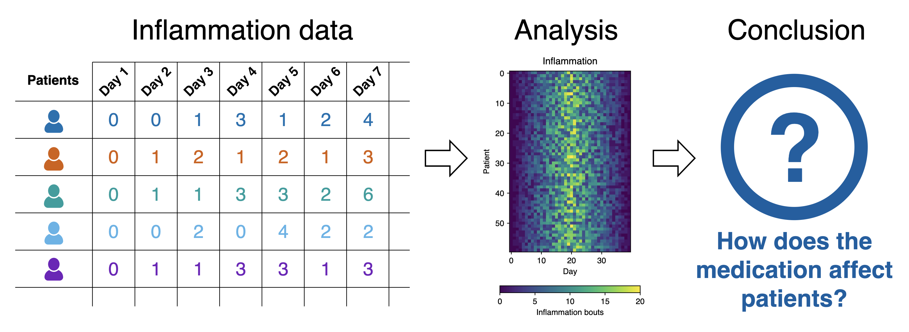

<!-- .slide: data-state="title" -->

<style>

/* Blockquote main style */
.blockquote {
    position: relative;
    font-weight: 800;
    padding: 30px 0;
    width: 100%;
    max-width: 500px;
    z-index: 1;
    margin: 80px auto;
    align-self: center;
    border-top: solid 1px;
    border-bottom: solid 1px;
}

/* Blockquote right double quotes */
.blockquote:after {
    position: absolute;
    content: "”";
    font-size: 10rem;
    line-height: 0;
    bottom: -43px;
    right: 30px;
}

/* Blockquote subheader */
.blockquote h4 {
    position: relative;
    font-size: 1.4rem;
    font-weight: normal;
    line-height: 1;
    margin: 0;
    padding-top: 20px;
    z-index: 1;
}

</style>

# Setting Up Environment For Collaborative Code Development & Intro to Our Software Project

===

<!-- .slide: data-state="standard 10" -->

## Introduction

In order to develop (write, run, test, debug, backup) code efficiently, you need to use a number of different tools interchangeably ​

- Introduction to software project and software development tools (refresher)​
  - Command line, IDE, Git + GitHub ​
- Setting up virtual development environment to isolate code (pip, venv)​
- Writing and checking for well-formatted and readable code - PEP8 coding style convention & linting​

===

<!-- .slide: data-state="standard 10" -->

# 1.1 Introduction to our software project

Patient Inflammation Study Project



==

<!-- .slide: data-state="standard 10" -->

# Project structure

```
├── data
│   ├── inflammation-01.csv
│   …
│   └── inflammation-12.csv
├── inflammation
│   ├── __init__.py
│   ├── models.py
│   └── views.py
├── inflammation-analysis.py
├── LICENCE.md
├── pyproject.toml
├── README.md
└── tests
    ├── test_models.py
    └── test_patient.py
```

==

<!-- .slide: data-state="standard 10" -->

# Model – View – Controller architecture


- Model (represents the data)
- View (interacts with the user), and
- Controller (handles input and output).

<!-- .element: class="fragment" data-fragment-index="1" -->

Example:
<!-- .element: class="fragment" data-fragment-index="2" -->
- I click on ‘summary of inflammation study results for these 10 patients’ (View)
- Controller accepts this input and asks Model for the appropriate data
- Model retrieves the data and sends it to Controller
- Controller analyses the data and sends it to View
- View presents the results

<!-- .element: class="fragment" data-fragment-index="2" -->

==

<!-- .slide: data-state="standard 10" -->

# Model – View – Controller architecture

- It makes sense to gather functionality that is related to each other in a module and make it clear how modules interact with each other (how they ‘interface’).
- This makes the code more **modular**, and thereby more **reusable, readable, and manageable**. We will get back to this in section 3.


===

<!-- .slide: data-state="standard 10" -->

# Instructions

- Follow instructions for "Downloading Our Software Project" (also carry out the exercise)
- Quickly go over "Our Software Project’s Structure", which we have covered in the presentation.

===
