<!-- .slide: data-state="title" -->

<link rel="stylesheet" href="dist/plugin/highlight/monokai.css" />
<script src="dist/plugin/highlight.js"></script>
<script>
  Reveal.initialize({
    plugins: [RevealHighlight],
  });
</script>

<style>

/* Blockquote main style */
.blockquote {
    position: relative;
    font-weight: 800;
    padding: 30px 0;
    width: 100%;
    max-width: 500px;
    z-index: 1;
    margin: 80px auto;
    align-self: center;
    border-top: solid 1px;
    border-bottom: solid 1px;
}

/* Blockquote right double quotes */
.blockquote:after {
    position: absolute;
    content: "”";
    font-size: 10rem;
    line-height: 0;
    bottom: -43px;
    right: 30px;
}

/* Blockquote subheader */
.blockquote h4 {
    position: relative;
    font-size: 1.4rem;
    font-weight: normal;
    line-height: 1;
    margin: 0;
    padding-top: 20px;
    z-index: 1;
}

</style>

# Software Development as a Process

===

<!-- .slide: data-state="standard 10" -->

## Programming VS Software Engineering

<div class="blockquote-wrapper fragment">
  <div class="blockquote" style="margin: 30px auto 0; font-size: smaller;">
    Software designed deliberately will be much easier to work with in the long term than software we build without a plan - time spent planning in advance will save you a lot more time later.
  </div>
</div>

Note:

The terms programming (or even coding) and software engineering are often used interchangeably. They are not. Someone who is engineering software takes a wider view:
The lifecycle of software: from understanding what is needed, to writing the software and using/releasing it, to what happens afterwards.
Who will (or may) be involved: software is written for stakeholders. This may only be the researcher initially, but there is an understanding that others may become involved later (even if that isn’t evident yet). A good rule of thumb is to always assume that code will be read and used by others later on, which includes yourself!
Software (or code) is an asset: software inherently contains value - for example, in terms of what it can do, the lessons learned throughout its development, and as an implementation of a research approach (i.e. a particular research algorithm, process, or technical approach).
As an asset, it could be reused: again, it may not be evident initially that the software will have use beyond its initial purpose or project, but there is an assumption that the software - or even just a part of it - could be reused in the future.

<!-- This seems to be a bit of an overview slide, but I don't feel it serves much purpose. -Sander
==

## Programming vs Software Engineering

Software requirements, design, architecture and implementation as typical stages of a software development process
- Design requirements and constraints - what affects our design choices?
- Software design	
- Writing readable, maintainable and testable code
- Pure functions, classes and abstractions

 -->

===

<!-- .slide: data-state="standard 10" -->

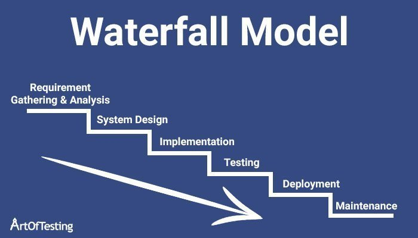

Note:

The software development process consists of multiple stages, which in the 'traditional (/ old fashioned)' waterfall model follows one step after another.
So far, you are all familiar with the "Implementation" step, as that 'simply' consists of the programming you're already doing, and you have worked a bit on the "testing" step too, to make sure what you've implemented is actually correct.
But it's also important to consider what you actually want to implement in the first place

*point out 'System Design'*

After all, it doesn't make sense to start programming if you haven't thought about what you're going to build in the first place.
But there's more you can take into account when designing your program than just how to implement and test it.

*point out 'Deployment' and 'Maintenance'*

How you deploy and eventually have/want to maintain your project can also influence your design decisions. 
Although Deployment and Maintenance are typically much less 'formal' in a research (and especially in an academic) setting compared to a corporate setting.
Think of the different in running your analysis for a paper compared to deploying a new version of the ns.nl website.
 
There is actually one more step in the process.
Just like you can't build without a design, you can't really design without knowing what you want.
 
*point out 'Requirement Gather & Analysis'* 
 
That's where properly specifying your requirements comes in.
Taking dedicated time to think about what the requirements of your project are can be vital in making the right (design) decisions at the start.
After all, the sooner you can correct or avoid a mistake, the cheaper it is.

==

<!-- .slide: data-state="standard 10" -->

<h2>Software development as a <i>continuous</i> process

<br><br> <!-- Adding vertical space -->

<div style="font-size: smaller;">
Requirements will <i>almost always</i> change on reflection!
</div>

==

<!-- .slide: data-state="standard 10" -->

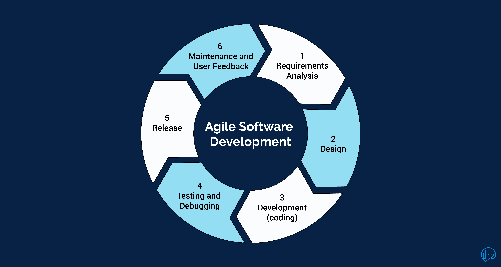

Note:

Image from: https://blog.stackademic.com/understanding-lean-startup-and-agile-development-c42677a95d03

===

<!-- .slide: data-state="standard 10" -->

## 3.1 Software Requirements

Write them down so you only build what's actually needed!

<ul>
  <div class="fragment" data-fragment-index="1">
    <li>Start high level
    <ul><li>What goal am I trying to achieve?</ul>
  </div>
  <br>
  <div class="fragment" data-fragment-index="2">
    <li>Refine
    <ul><li>What feature do I need do achieve this?</ul>
  </div>
  <br>
  <div class="fragment" data-fragment-index="3">
    <li>Make specific
    <ul><li>How do I implement that?</ul>
  </div>
</ul>

Note:

For the first episode of this section, we'll focus on the requirements step. To really think about them, and give yourself the best chance of sticking to them later, it's best to actually write down your requirements.

This will probably feel like a lot of overhead, so will take some discipline. But by writing it down, you're forcing yourself to be specific, which helps to identify problems as soon as possible, saving you a lot of time later in the process.

When thinking about requirements of code, we should avoid the temptation to immediately think in terms of code, but instead start at a high level.

** reveal 'Start high level' **

First make sure you identify what goal you're actually trying to achieve. Again, we don't want to build anything we're never going to need.

** reveal 'Refine' **

When the goal is clear, we can refine it down to start defining features the software should have...

** reveal 'Make specific' **

… which can be further specified by implementation details.

These three levels can be named 'business', 'user, and 'solution', requirements. Although as the lesson materials mention, this naming scheme is actually quite arbitrary, and you may find different terminology being used in different contexts.

>> For this episode, talk through the exercises as a group.

===

<!-- .slide: data-state="standard 10" -->

## 3.2 Software Architecture and Design

<ul>
  <div class="fragment" data-fragment-index="1">
    <li>Software/System Architecture
    <ul><li>How do components interact?</ul>
  </div>
  <br>
  <div class="fragment" data-fragment-index="2">
    <li>UI/UX
    <ul><li>How do users interact with the software?</ul>
  </div>
  <br>
  <div class="fragment" data-fragment-index="3">
    <li>Algorithm Design
    <ul><li>How to solve the core research/business problem?</ul>
  </div>
</ul>

Note:

Now we have (some version of) the requirements in place, the next step is designing before we can get to implementation.

Software can be designed at very different levels. Just like buildings, where an architect designs the overall shape in collaboration with engineers to make sure the available materials can actually support it, all the way down to an interior designer who lays out the exact details of which pieces of furniture go where.

You can consider many aspects of design, but here are three common ones:

** reveal Architecture **

Architecture is the high-level design. Which (large) components does your software currently consist of, which ones will have to be added, changed or removed? And not just considering your own software, but also the wider system around it: which other software does your software interact with? Web APIs are commonly a part of this.

Think back to the "Model-View-Controller" architecture you encountered earlier. It's a way of splitting up the responsibilities of your program into separate components so we can think about their interaction at a higher level. This can be helpful, but will have its limits. No separation will ever be perfect, and certain functionality can be argued to be part of different components in the same software. There's a lot of examples with specific terminology that you can choose from if you want. It's good to be aware of common patterns: they usually appeared after many hard lessons have been learned. But don't feel to stuck by them, it should **help** your efforts in creating the code, not hold you back.

** reveal UI/UX **

The User Interface or User eXperience is also subject to design. Think about clunky apps or websites, or completely losing track of how to do things when software you use frequently ( *cough* MS Teams *cough*) decides to change things? If there is a preferred order of things, make sure that's easy for your users! They don't have to follow the structure of your code when interacting.

** reveal Algorithm Design **

Now we're almost getting to the meat of things: which algorithms and data structures will we actually use to solve the problem we identified in the requirements? Don't forget your (non-)functional user requirements here. The space-time trade-off is commonly made here depending on your restrictions: should it be fast and do you have the space to pre-compute and memorize, or is your memory limited and is a bit of extra time not a problem?

Again, these are just common examples of what to think of when designing.

==

<!-- .slide: data-state="standard 10" -->

## Good Code

<div style="display: flex; gap: 1em; font-size: smaller;">
  <div class="fragment" data-fragment-index="1">
    <div class="blockquote" style="margin: 30px auto 0; font-size: smaller;">
        … is readable, understandable, covered by automated tests, not over complicated and does well what is intended to do
      <h4>&mdash; Intent HQ blog</h4>
    </div>
  </div>
  <div style="flex: 1;" class="fragment" data-fragment-index="2">
    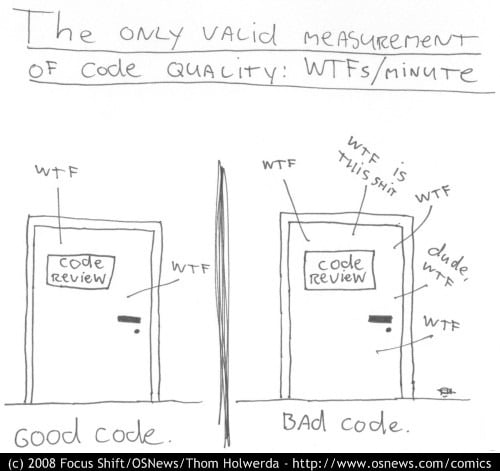
  </div>
</div>

Note:

blog: https://intenthq.com/writing/what-is-good-code-a-scientific-definition

The point of spending all this time designing our code, is to make sure we produce "good code" in the end. The following quote sums it up quite nicely:

** click to reveal quote ** 

Readability and understandability goes all the way from using sensible variable names, to how you've chosen to construct your software in terms of components. The logic should be easy to see, and should make sense when explained.

Having code be testable / tested means you have some guarantee that it actually does what it's supposed to do, and also means the behavior of your components is defined well enough that you can check it.

Together, this makes code **maintainable**. In short: that you won't dread having to go back to your code in a few months time if you have to find and fix a bug, or extend it to support new functionality.

==

<!-- .slide: data-state="standard 10" -->

## Finding balance

<div style="display: flex; gap: 1em; font-size: smaller;">
  <div style="flex: 1;" class="fragment" data-fragment-index="3">

  - Under-design
  - Technical Debt

  </div>
  <div style="flex: 2;" class="fragment" data-fragment-index="1">
    
  </div>
  <div style="flex: 1;" class="fragment" data-fragment-index="2">

  - Over-design
  - Overhead

  </div>
</div>

Note:

Okay, so now we've covered what aspects go into designing software, and what you should pay attention to when doing so. So when we do decide we've designed enough? When are we done with preparing, and can we actually start coding?!

** click to reveal image **

There is no fixed answer here, it's all a balancing act you will have to experience for yourself

** click to reveal under-design/tech debt **

The whole point of designing is not to under-design, we want to avoid technical debt!

For those unfamiliar with the term "technical debt": it is basically a shorthand for work that has to be done on refactoring/redesigning code before it becomes possible to expand it with new features. It's usually caused by under-designing and rushing implementations, choosing quick fixes over steady improvements.
It's referred to as 'debt' because by choosing those quick fixes, you're effectively "borrowing" time from the future with interest: by not spending the time designing now, you can get your feature out faster, but that lack of design will come back for you later, when it's even harder to fix because more stuff has been added, and you need extra time to get re-acquainted with the context.

You could compare it to choosing not to do the dishes right after dinner, but doing it the next day instead: You gain the free time now, but tomorrow you still have to do it, and now it's all gotten stuck and is even harder to clean.

** click to reveal over-design **

The flip-side is over-designing: in the extreme case, you'd just keep designing and never get to coding, which isn't the point either. At least, the more important, larger, or more long-lived your software will be, the more time it makes sense to spend on designing. After all, the point of designing is to prevent mistakes. In small or short-lived software, there's a lot less that **can** even go wrong, than in a larger project.

===

<!-- .slide: data-state="standard 10" -->

## 6 Techniques for Good Software Design

Episode 3.3
- Code Abstraction
- Code Decoupling
- Encapsulation
- Polymorphism

Episode 3.4
- Code Refactoring
- Pure Functions

===

<!-- .slide: data-state="standard 10" -->

## 3.3 Code Abstraction

<div style="display: flex; gap: 1em; font-size: smaller;">
  <div style="flex: 1;">

Details of ‘how’ something works are hidden. You only deal with ‘what’ the code does.

You (or a user of your code) only need to understand the higher level of abstraction and not the details.

  </div>
  <div style="flex: 1;">
    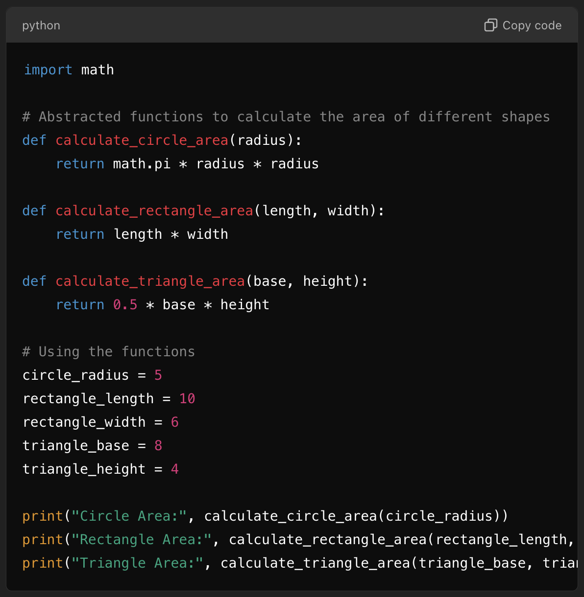
  </div>
</div>

==

<!-- .slide: data-state="standard 10" -->

## 3.3 Code Decoupling

<div style="display: flex; gap: 1em; font-size: smaller;">
  <div style="flex: 1;">

Breaking up software in smaller components to reduce the interdependence.

A change in one component does not necessitate a change in the other.

Clear interface between components

  </div>
  <div style="flex: 1;">
    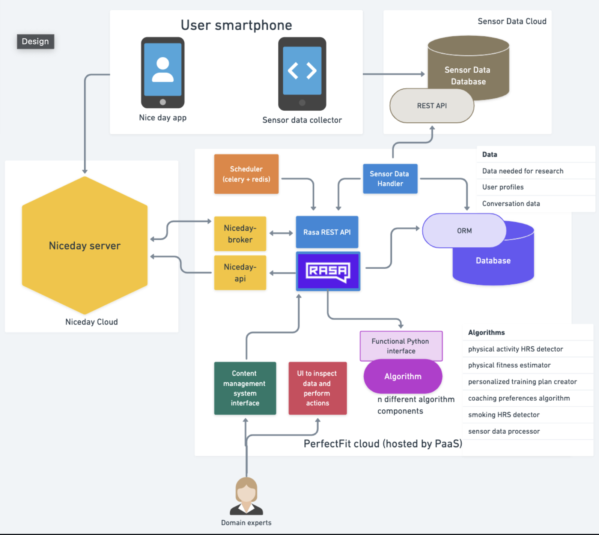
  </div>
</div>

==

<!-- .slide: data-state="standard 10" -->

## 3.3 Encapsulation

<div style="display: flex; gap: 1em; font-size: smaller;">
  <div style="flex: 1;">

Packing data and functions operating on it in a single component.

In Python you can group together data and methods in a class. An instance of a class is called an object.

  </div>
  <div style="flex: 1;">
    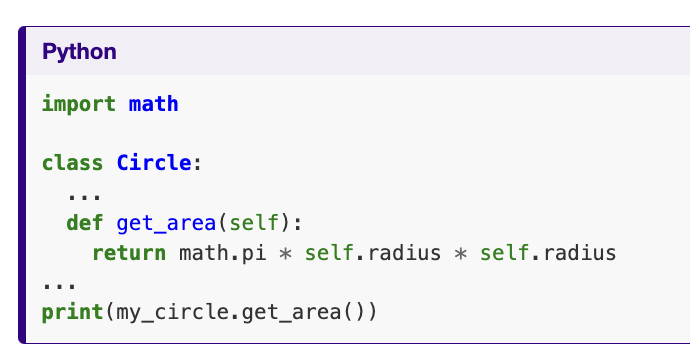
  </div>
</div>

<!-- 
```python
import math

class Circle:
    ...
    def get_area(self):
        return math.pi * self.radius * self.radius
...
print(my_circle.get_area())
```
 -->

==

<!-- .slide: data-state="standard 10" -->

## 3.3 Polymorphism

<div style="display: flex; gap: 1em; font-size: smaller;">
  <div style="flex: 1;">

Having multiple implementations/shapes of the same abstract concept

  </div>
  <div style="flex: 1;">
    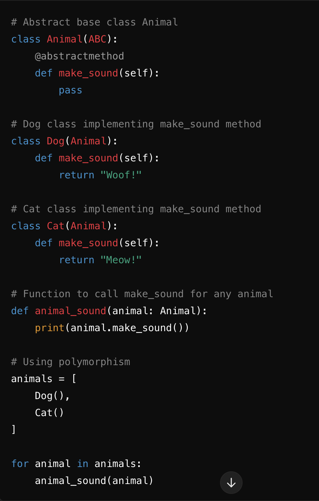
  </div>
</div>

==

<!-- .slide: data-state="standard 10" -->

## 3.3 Testing with Mocks

- When writing tests for some functionality, you want to depend on as little other functionality
- A _mock_ is an object for which you define just enough behavior so it can take the place of a different object in your tests

Sounds familiar?
<!-- .element: class="fragment" data-fragment-index="2" -->

- Concept has been encapsulated
<!-- .element: class="fragment" data-fragment-index="3" -->
- Implementation has been abstracted
<!-- .element: class="fragment" data-fragment-index="3" -->

===

<!-- .slide: data-state="standard 10" -->

## 3.4 Code Refactoring

Improving the structure of the code, without altering its function.

How can we ensure that the code still works after refactoring?

Note:

Inevitably, at some point you'll encounter code that is not designed as you'd want it to.
Whether not deliberately designed in the first place, or the latest requirements just no longer matching the previous design. That's just a natural part of iterative software development.

Refactoring is the process of redesigning existing code. If done at the same time as adding new functionality, any newly introduced bugs will be very hard to solve. Instead, it's easier to keep the functionality constant first, and then add the new feature later.

Wanting to keep the functionality constant, how do we ensure this is the case after our refactor? If you think back to the previous section, we've already discussed the ideal tool for this: tests! If our code is well tested, any change in functionality should fail at least one test. So if we redesigned the code and our tests still pass, we can be fairly sure that it still works just like before. Except now it will be easier to add the new feature we were considering.

==

<!-- .slide: data-state="standard 10" -->

## 3.4 Pure vs Impure functions

Pure functions are easy to read, write, test and maintain, because they have no _side effects_:

- Perform an action
- Leave input unchanged

Need to change something? Return a changed copy!

==

<!-- .slide: data-state="standard 10" -->

## Example: Impure functions

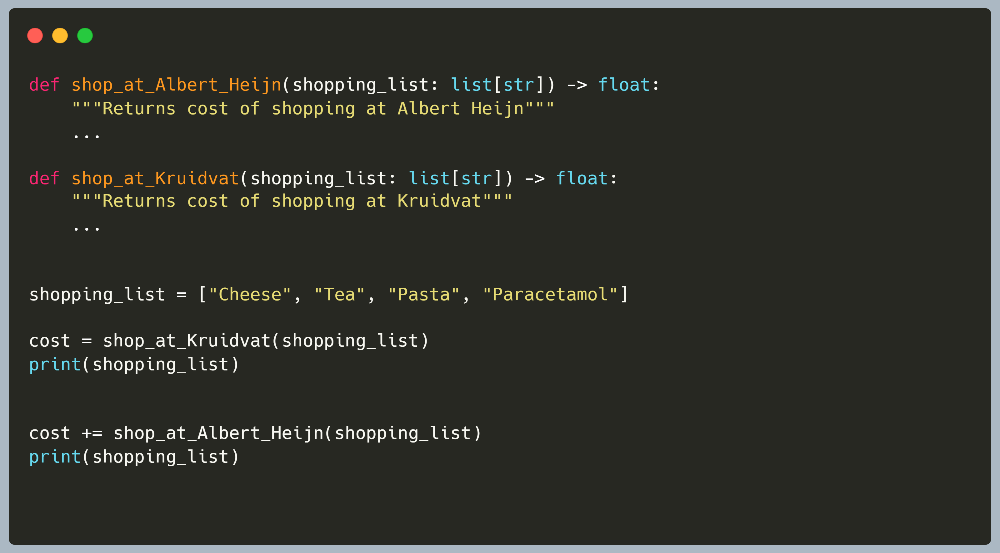

<!--

```python
def shop_at_Albert_Heijn(shopping_list: list[str]) -> float:
    """Returns cost of shopping at Albert Heijn"""
    ...

def shop_at_Kruitvat(shopping_list: list[str]) -> float:
    """Returns cost of shopping at Kruitvat"""
    ...

shopping_list = ["Cheese", "Tea", "Pasta", "Paracetamol"]

cost = shop_at_Kruitvat(shopping_list)
print(shopping_list)

cost += shop_at_Albert_Heijn(shopping_list)
print(shopping_list)
```

-->

Note:

Here is an example of an impure function in use: We have two functions `shop_at_Albert_Heijn` and `shop_at_Kruidvat` that calculate the price of buying products from a shopping list at their stores.
Kruidvat sells tea and paracetamol, but does not sell cheese or pasta, so we will have to buy those products at Albert Heijn using the second function.

These functions work just like how you would use a shopping list in person: once you've bought a product, that product is crossed out or removed from your list.

==

<!-- .slide: data-state="standard 10" -->

## Example: Impure functions

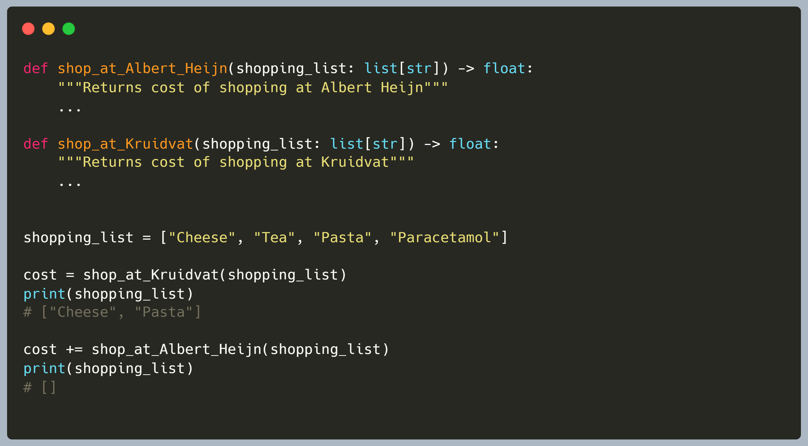

<!--

```python
def shop_at_Albert_Heijn(shopping_list: list[str]) -> float:
    """Returns cost of shopping at Albert Heijn"""
    ...

def shop_at_Kruitvat(shopping_list: list[str]) -> float:
    """Returns cost of shopping at Kruitvat"""
    ...

shopping_list = ["Cheese", "Tea", "Pasta", "Paracetamol"]

cost = shop_at_Kruitvat(shopping_list)
print(shopping_list)
# ["Cheese", "Pasta"]

cost += shop_at_Albert_Heijn(shopping_list)
print(shopping_list)
# []
```

-->

Note:

As you can see, the tea and paracetamol have now been removed from the shopping list.
This means that when using the same `shopping_list` variable, we only end up buying cheese and pasta at Albert Heijn instead of the full list.
In this case that is the intended behavior of the programmer, but it does make the function harder to use generically, harder to document and harder to test.
For example, we can't easily re-use the same shopping list to check which order of shopping would be cheaper: our shopping list is empty after calling both for the first time, and in this case we don't have a copy of the original anymore.

In short, a pure function should always return the same output for the same input, and should not change anything outside itself.
This also means it should be independent of any other local/global variables that may be around.
By writing our functions this way, they usually become easier to work with, and especially to test: there will never be any (unexpected) dependencies on other tests or state.

==

<!-- .slide: data-state="standard 10" -->

## Example: Pure functions

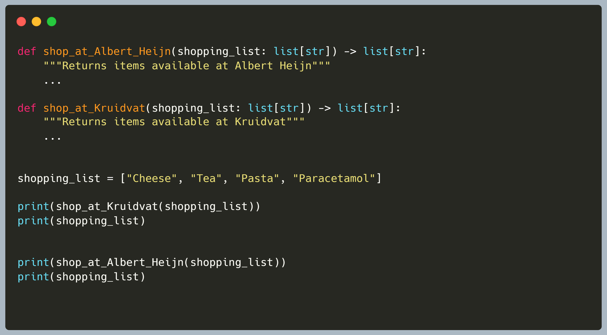

<!--

```python
def shop_at_Albert_Heijn(shopping_list: list[str]) -> list[str]:
    """Returns items available at Albert Heijn"""
    ...

def shop_at_Kruitvat(shopping_list: list[str]) -> list[str]:
    """Returns items available at Kruitvat"""
    ...

shopping_list = ["Cheese", "Tea", "Pasta", "Paracetamol"]

print(shop_at_Kruitvat(shopping_list))
print(shopping_list)


print(shop_at_Albert_Heijn(shopping_list))
print(shopping_list)
```

-->

Note:

How might we rewrite this to be pure functions?
One way could be to first create a function that returns a new list with only those items available at that store

==

<!-- .slide: data-state="standard 10" -->

## Example: Pure functions

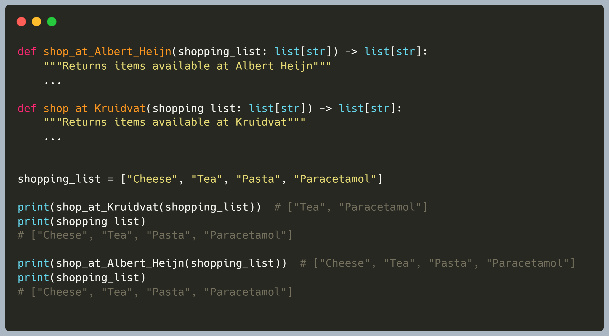

<!--

```python
def shop_at_Albert_Heijn(shopping_list: list[str]) -> list[str]:
    """Returns items available at Albert Heijn"""
    ...

def shop_at_Kruitvat(shopping_list: list[str]) -> list[str]:
    """Returns items available at Kruitvat"""
    ...

shopping_list = ["Cheese", "Tea", "Pasta", "Paracetamol"]

print(shop_at_Kruitvat(shopping_list))  # ["Tea", "Paracetamol"]
print(shopping_list)
# ["Cheese", "Tea", "Pasta", "Paracetamol"]

print(shop_at_Albert_Heijn(shopping_list))  # ["Cheese", "Tea", "Pasta", "Paracetamol"]
print(shopping_list)
# ["Cheese", "Tea", "Pasta", "Paracetamol"]
```

-->

Note:

With these new functions, our original shopping list is unchanged.
We could then write separate functions that calculate the price for certain items at a certain store.
Those can then be combined in another function that takes care of buying things from the shopping list in order so we don't buy anything twice.
Note that this is just an example/suggestion, and other/better ways of structuring functionality might be possible

However we end up **refactoring** the original implementation, while it might be a bit more work to separate out the functions like this, we do end up with functions that are smaller, do a single clear thing and are much easier to test.

The concept of only programming with such pure functions is a paradigm called _functional programming_, and is one of several programming paradigms that Python supports.
(Other paradigms can include procedural and object oriented programming)

===
